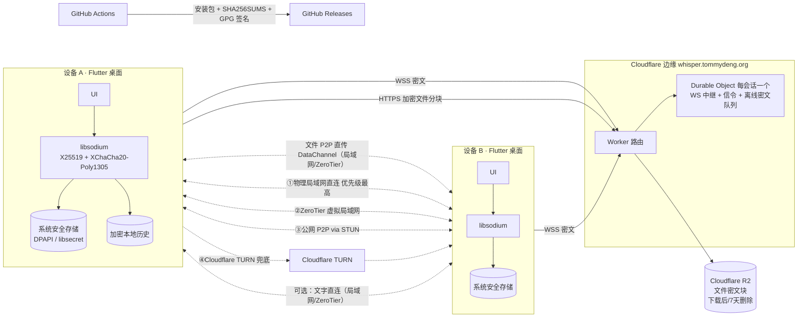

# 耳语（Whisper）技术架构 · Stage 1（修订：原生客户端）

> 原则：**原生 Flutter 客户端**负责全部加密与业务；Cloudflare 只做“哑转发”。不提供 Web 版。

## 1. 总览
- **客户端**：Flutter 桌面应用，首发 **Windows、Linux**；后续用同一代码库发布 **iOS、Android**。
- **中继**：**Cloudflare Workers + Durable Objects**（`whisper.tommydeng.org`），每会话一个 DO，仅负责 WebSocket 密文中继、WebRTC 信令和离线密文队列。**不使用 Cloudflare Pages，无 Web 前端。**
- **加密**：客户端用 **libsodium**（`sodium_libs`）或 Dart `cryptography` 包。
- **密钥存储**：系统安全存储，通过 `flutter_secure_storage`：Windows DPAPI / 凭据管理器，Linux libsecret（GNOME Keyring / KWallet）。
- **语音**：`flutter_webrtc` P2P，DTLS-SRTP；**局域网优先**：物理局域网 → ZeroTier → 公网 STUN → Cloudflare TURN（免费额度内，MVP 启用）。
- **存储**：服务端无数据库（D1/KV 仅必要时）；离线消息密文在 DO 存储；离线文件密文分块在 **Cloudflare R2**（超出免费额度需所有者批准）。客户端本地历史使用加密 SQLite（如 SQLCipher），默认 7 天自动删除。
- **MVP 约束**：一台设备 = 一个身份（无多设备/备份）；仅 1:1 会话。

## 2. 身份与密钥
- 首次启动用 libsodium 生成 **X25519 身份密钥对**（另含 Ed25519 签名密钥，用于签名预密钥/邀请）。
- 私钥经 `flutter_secure_storage` 存入系统安全存储，不写入普通文件、不出现在日志。
- **安全码**：双方公钥排序拼接后用 BLAKE2b/SHA-256 哈希，显示为 12 组 5 位数字 + 二维码。
- Linux 无可用 keyring（如精简桌面）时：提示安装 gnome-keyring，或使用用户口令（Argon2id 派生）加密的本地密钥文件作为退路。

## 3. 配对流程（桌面）
1. **当面**：A 窗口显示二维码（公钥 + 一次性会话 ID + token）；B 用摄像头扫描（桌面摄像头扫码库，如基于 `camera` + `zxing`/`mobile_scanner` 的桌面支持，需验证）。扫码成功双方自动标记“已验证”。
2. **无摄像头/远程**：A 生成**邀请码**（Base32 文本，可复制）或 `whisper://invite#...` 链接（注册 URL scheme），通过私下渠道发给 B，B 粘贴即可。默认“未验证”，需通过电话等比对安全码。
3. 邀请 token 一次性、24h 过期，过期或已用即由 DO 拒绝。
4. **邀请人手动批准**：B 使用邀请码后，A 收到配对请求（显示 B 的安全码/指纹），A 点击批准后才建立会话；拒绝或 24h 未处理则作废。
5. 会话 ID 随机生成，作为 DO 名称，不含身份信息。

## 4. 消息加密
- **MVP**：`crypto_kx`/X25519 共享秘密 → HKDF/BLAKE2b 派生会话密钥 → **XChaCha20-Poly1305**（首选，192-bit 随机 nonce 无碰撞顾虑）；AES-256-GCM 作为备选（需硬件 AES 支持检测）。附加数据含会话 ID + 序号，防重放/重排。
- 消息填充至固定长度区间，减少长度泄露。
- **后续升级**：X3DH + 双棘轮（Double Ratchet），提供前向保密与泄露后恢复。

## 5. 存储与留存
| 位置 | 内容 | 留存 |
|---|---|---|
| 系统安全存储 | 身份私钥、本地数据库密钥 | 直到用户清除；无备份（MVP） |
| 本机加密 SQLite | 消息历史、已下载文件（加密） | 默认 7 天自动删除；按会话可开阅后即焚（读后双方删除，对方客户端配合执行，不能防截屏） |
| DO 存储 | 离线消息密文、配对请求 | ACK 后删除；最长 7 天 |
| R2 | 离线文件密文分块 | 下载 ACK 后删除；最长 7 天（R2 生命周期规则兜底） |

### 文件与图片传输
- **传输路径优先级**：① 局域网（物理局域网 / ZeroTier）直连 → ② 公网 P2P 直连 → ③ R2 中转（最后手段，100MB 上限）。**文件数据永不经 TURN 传输**（TURN 仅用于语音和信令兜底），避免 TURN 流量与费用。
- **上限按路径决定**：
  | 条件 | 单文件上限 | 通道 |
  |---|---|---|
  | 对方在线 + 直连（局域网 / ZeroTier / 公网 P2P，选中的 ICE 候选对不是 relay） | **100GB** | P2P 直传 |
  | 对方离线，或仅 TURN 中继可用 | **100MB** | R2 中转 |
  发送前由客户端检查当前选中候选对类型；若选中候选对为 relay（TURN），文件通道不使用它：≤ 100MB 改走 R2，> 100MB 提示需直连。传输中直连断开时暂停等待直连恢复（绝不切到 TURN）。
- 每个文件生成随机 32 字节密钥；文件密钥、文件名、大小、整文件哈希只放在 E2EE 消息中。
- **大文件直传设计**：
  - **流式分块加密**：从磁盘按块读取（如 1–4MB），逐块加密发送；接收端逐块解密写入临时文件，**整个文件不进内存**。
  - **逐块 AEAD**：每块独立 XChaCha20-Poly1305，nonce/附加数据含文件 ID + 块序号 + 是否末块，防止重排、截断、替换；**整文件哈希**（BLAKE2b/BLAKE3）完成后校验，通过后再原子重命名为最终文件。
  - **断点续传**：接收端按块 ACK，持久化已收块位图；断线/重启后双方交换位图，只补传缺失块。
  - **流控/背压**：WebRTC DataChannel 依据 `bufferedAmount` + `bufferedAmountLowThreshold` 控制发送；可并行多个 DataChannel 提升吞吐。
  - **可选通道**：在局域网/ZeroTier 下，可考虑经 E2EE 信令协商后直接用 QUIC/TCP 套接字传输（同样逐块 AEAD），吞吐更高；作为后续优化，需评估防火墙与实现成本。
  - **用户体验**：进度、速度、剩余时间、暂停/继续/取消；开始前检查接收方磁盘剩余空间（需 ≥ 文件大小 + 余量），不足则拒绝并提示。
  - 取消或失败后清理临时文件；未完成的临时文件也受 7 天本地留存规则约束。
- **R2 中转（≤ 100MB）**：分块（如 1MB）用 XChaCha20-Poly1305 secretstream 加密；Worker 签发短期上传/下载授权（预签名 URL 或经 Worker 代理），对象名随机；文件密钥、哈希、大小等只放在 E2EE 消息中。接收方下载完成 ACK 后删除；R2 生命周期规则 7 天强制删除。
- 每会话上传速率/配额限制，防止滥用；R2 用量监控，**超出免费额度需所有者批准**。

## 6. 中继与离线队列（Durable Object）
- 每会话一个 DO，使用 WebSocket Hibernation API 降低费用。
- 对方在线直接转发；离线时密文写入 DO 存储，收到 ACK 即删除，最长保留 7 天。
- 仅校验会话 ID、消息大小、速率；关闭不必要日志，不记录 IP。
- 承担 WebRTC 信令（SDP/ICE），信令经 E2EE 加密。

## 7. 语音
- `flutter_webrtc` P2P，DTLS-SRTP；DTLS 指纹经 E2EE 信令传递，防篡改。
- **连接优先级（局域网优先）**：
  1. **物理局域网**：host 候选（局域网 IP）；可选 mDNS 发现同网段联系人（广播内容仅为随机、轮换的标识，不含身份）。
  2. **ZeroTier 虚拟局域网**：识别 ZeroTier 网卡（如 `zt*` 接口、Windows 的 ZeroTier 虚拟适配器，或配置的 ZeroTier 网段），提高其 host 候选优先级；实现方式：在 SDP 交换前调整 ICE candidate priority / 按网卡偏好排序，或通过 RTCConfiguration 的网络过滤（视 flutter_webrtc 支持情况）。
  3. **公网 P2P**：STUN `stun.cloudflare.com`，srflx 候选。
  4. **Cloudflare TURN 中继兜底**：所有者确认在 Cloudflare 免费额度内，**MVP 默认启用**。TURN 凭据由 Worker 按需签发短期凭据（不在客户端硬编码长期密钥）。需监控用量；**超出免费额度产生的费用仍需所有者批准**（可设用量告警/上限）。
- ICE 允许全部候选并行收集，但通过优先级保证可用时优先选中局域网/ZeroTier；UI 显示当前路径（局域网 / ZeroTier / 公网 / 中继）便于测试。
- **ZeroTier 不是安全边界**：即使在 ZeroTier 内，DTLS-SRTP 与 E2EE 始终开启，安全码验证不变。无 ZeroTier 时自动退回 STUN/TURN。
- **可选（文字直连）**：双方在线且在局域网/ZeroTier 可达时，可通过 WebRTC DataChannel 直接传输已加密消息，否则经 Durable Object 中继；离线队列仍在 DO。MVP 可不做，列为可选。
- Linux 依赖 PulseAudio/PipeWire；Windows 使用 WASAPI（由 libwebrtc 处理）。

## 8. 打包、更新与签名
| 平台 | 打包 | 签名 | 更新 |
|---|---|---|---|
| Windows | exe 安装器（Inno Setup）+ 便携 zip；（MSIX 必须签名才能正常安装，故不作为主要分发方式） | **不购买代码签名证书（所有者决定）**，安装包未签名；首次运行出现 SmartScreen 警告，用户点“更多信息 → 仍要运行”；以 SHA-256 + GPG 签名校验和保证完整性 | MVP：应用内检查 GitHub Releases 新版本并提示下载；后续评估 MSIX App Installer 自动更新 |
| Linux | AppImage + deb | GPG 签名发布文件 + SHA-256 校验和 | AppImage 可用 AppImageUpdate；deb 先手动，后续可建 apt 源 |
| iOS/Android（后续） | App Store / APK 或 Play | Apple 开发者账号（付费）、Android keystore | 商店更新 |

- **发布完整性**：每个 GitHub Release 附 `SHA256SUMS`（所有安装包的 SHA-256）和 GPG 签名的 `SHA256SUMS.asc`；README 公布 GPG 公钥指纹，并写明 Windows（`Get-FileHash`、`gpg --verify`）与 Linux（`sha256sum -c`、`gpg --verify`）验证步骤，以及 SmartScreen“更多信息 → 仍要运行”的截图说明。
- 自动更新：应用内检查新版本，下载后用内置的 GPG 公钥（或固定的 Ed25519 发布公钥）校验签名的校验和文件，校验通过才提示安装；绝不静默安装。
- GPG 发布私钥仅所有者持有（离线签名或存 GitHub Actions Secrets，需所有者决定）。

## 9. CI（GitHub Actions）
- PR 触发：`flutter analyze`、`flutter test`（含加密单元测试向量）、Worker 测试。
- 构建矩阵：`windows-latest` → exe + zip；`ubuntu-latest` → AppImage/deb（安装 `libgtk-3-dev`、`libsecret-1-dev`、`libpulse-dev` 等）。
- 打 tag 时发布 GitHub Releases，附 `SHA256SUMS` 与 GPG 签名 `SHA256SUMS.asc`。
- Worker 部署（wrangler）仅在 `main` 合并后由所有者批准的 workflow 执行。
- 依赖锁定（`pubspec.lock`、`package-lock.json`），Actions 按 commit SHA 固定版本。

## 10. 风险清单
| 风险 | 说明 | 缓解 |
|---|---|---|
| flutter_webrtc 桌面成熟度 | Windows/Linux 支持弱于移动端，设备选择、回声消除可能有问题 | 早期做 Win↔Linux 通话 spike；锁定版本；必要时打补丁 |
| Linux 音频/系统依赖 | PulseAudio/PipeWire、libsecret、GTK 版本差异；keyring 缺失 | AppImage 打包依赖；deb 声明依赖；无 keyring 时口令加密退路 |
| 桌面摄像头扫码 | Flutter 桌面相机/扫码插件支持有限 | 粘贴邀请码作为一等方案 |
| NAT 穿透失败 | 对称 NAT 下 P2P 打不通 | Cloudflare TURN 兜底（MVP 启用） |
| TURN 用量超出免费额度 | 中继流量大时可能产生费用 | 用量监控与告警、短期凭据、限速；超额需所有者批准 |
| ZeroTier 候选优先级不可控 | flutter_webrtc 未必暴露网卡过滤/优先级接口；ZeroTier IP 可能被当普通 host 候选 | SDP 候选重写排序；spike 验证；最坏情况仍可通过普通 host/STUN 连接 |
| 误把 ZeroTier 当安全边界 | 认为内网即安全而降低加密 | 架构约束：任何路径 E2EE 不可关闭；代码审查检查 |
| mDNS/局域网发现泄露元数据 | 局域网内他人可见设备存在 | mDNS 可选、默认关闭或仅广播随机轮换标识 |
| 密钥丢失/换设备 | 一台设备一个身份且无备份，重装或换机即丢失身份与历史 | 已确认为 MVP 取舍，UI 明确提示；后续加密备份/多设备 |
| 大文件直传性能/稳定性 | flutter_webrtc 桌面 DataChannel 吞吐有限，SCTP 大消息、背压与长时间传输可能不稳定 | 背压控制、多通道并行、断点续传；spike 测量吞吐；必要时改用局域网/ZeroTier 直连 QUIC/TCP |
| 内存/磁盘问题 | 一次性加载 100GB 文件会崩溃；磁盘写满 | 严格流式处理；传输前检查空间；临时文件清理 |
| 直连误判为中转（或反之） | 判断错误会使大文件走 TURN 产生流量费用 | 以选中候选对类型为准；传输中持续检测，降级到 relay 即暂停 |
| 大文件完整性 | 长时间传输出错或被篡改 | 逐块 AEAD + 整文件哈希 + 重传 |
| R2 用量/费用 | 大文件频繁中转超出免费额度 | 中转 100MB 上限（大文件仅直连）、7 天生命周期、下载即删、配额与用量告警；超额需批准 |
| 文件元数据泄露 | R2/Worker 可见文件密文大小与时间 | 随机对象名、可选大小填充；无法完全消除 |
| 阅后即焚的局限 | 依赖对方客户端执行删除，无法防截屏或改版客户端 | UI 如实说明 |
| 邀请批准被忽视 | 邀请人未及时批准导致配对失败 | 通知提示；24h 后作废需重新邀请 |
| Windows 未签名 | SmartScreen 警告、部分杀毒软件误报，亲友可能不敢安装 | 已决定不买证书；文档说明“仍要运行”，校验和 + GPG 验证；可向杀毒厂商提交误报 |
| Apple 账号费用（后续） | iOS 发布需付费账号 | 到移动端阶段再由所有者决定 |
| 更新通道被劫持 | 恶意更新包 | 签名校验、HTTPS、仅提示不静默安装 |
| 免费额度限制 | Workers 请求、DO 时长/存储 | Hibernation、大小/速率限制、监控 |
| 元数据泄露 | Cloudflare 可见 IP、时间、大小、频率 | 不记日志、填充、随机会话 ID；无法完全消除 |

## 11. Stage 2 任务拆分
1. `feat/scaffold`：Flutter 项目（Windows/Linux）、Worker + DO 骨架、GitHub Actions 构建矩阵。
2. `feat/webrtc-spike`：Windows↔Linux `flutter_webrtc` 通话验证，含 ZeroTier 网卡识别与候选优先级调整可行性（尽早降低最大风险）。
3. `feat/identity`：libsodium 密钥生成、`flutter_secure_storage`、安全码。
4. `feat/pairing`：二维码显示、摄像头扫码、邀请码粘贴、`whisper://` scheme、一次性 24h token、邀请人手动批准流程。
5. `feat/relay`：DO WebSocket 中继、离线密文队列、ACK 删除、限速。
6. `feat/e2ee-text`：XChaCha20-Poly1305 聊天、加密本地历史、7 天自动删除、按会话阅后即焚、清除数据。
7. `feat/voice`：E2EE 信令 + P2P 语音、局域网优先的 ICE 策略、路径显示。
8. `feat/turn`：Worker 签发 Cloudflare TURN 短期凭据、用量监控/告警。
9. `feat/files`：文件/图片 E2EE——按路径判定上限（直连 100GB / 中转 100MB）；流式分块加密读写磁盘、逐块 AEAD + 整文件哈希、按块 ACK 断点续传、DataChannel 背压与多通道、进度/暂停/取消、磁盘空间检查；R2 中转与签名授权、下载后删除 + 7 天生命周期、用量监控；评估局域网/ZeroTier 直连 QUIC/TCP（可选）。
10. `feat/lan-discovery`（可选）：mDNS 发现；`feat/direct-text`（可选）：局域网/ZeroTier DataChannel 文字直连。
11. `feat/packaging`：exe（Inno Setup）+ zip、AppImage/deb、SHA256SUMS + GPG 签名、SmartScreen 安装说明、Release 流程、更新检查。
12. `feat/hardening`：安全测试、验收清单走查（含文件传输、留存删除验证），含三路径（局域网 / ZeroTier / 仅 TURN）通话测试。

## 12. 分支策略
- `main` 受保护：禁止直接推送，必须通过 PR + CI 通过。
- 工作在 `feat/*`、`docs/*`、`fix/*` 分支进行。
- 所有 PR 需**所有者（TommyDeng）批准**后合并；涉及付费（TURN 或 R2 超出免费额度、Apple 账号、D1/KV 付费档）需单独批准。

## 附：发布签名密钥（所有者决定，2026-11-02）

- GPG 发布签名私钥以加密形式存放在 GitHub Actions Secrets（私钥 + 口令两个 secret），CI 在发布时自动对 `SHA256SUMS` 生成 `SHA256SUMS.asc`。
- README 公布公钥指纹；密钥泄露时立即吊销并轮换，并在 Release 说明中公告。
- 此项不再是待定问题。
